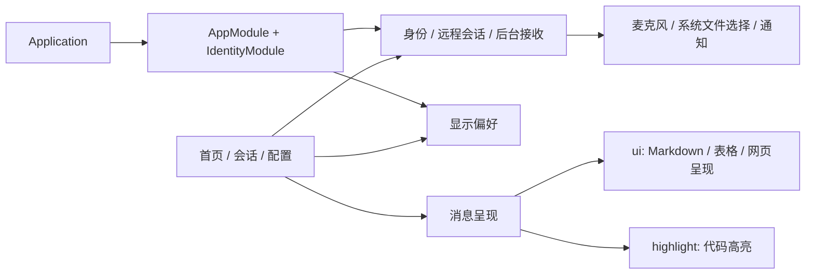

# Fairy 客户端运行组成

2026-10-19。Android 客户端围绕首页互动、会话对话和分组配置装配。源码起点是 `505f02c2969efe46f8a1cca3fc831e00f559429e` 加本轮开始时已有的 Fairy 页面改动；本轮结果位于当前工作区。

## 装配与保留理由

| 保留能力 | 当前用途 | 实现位置 |
| --- | --- | --- |
| 身份、会话归属、法厄同网关 | 登录后进入自己的会话，法厄同配置共用模型并生成邀请码 | `data/remote/`、`ui/identity/`、`ui/fairy/FairySettingsPage.kt` |
| 发送确认、重连、通知消费记录 | 发送状态不确定时对账，后台接收与恢复时合并提醒 | `RemoteChatState`、`RemoteReceiveState`、`ChatSyncStore` |
| 录音、文件选择与上传下载 | 语音转写回到草稿，图片和文件传给远程会话 | `RemoteSpeechCapture`、`RemoteAttachmentFiles`、`RemoteChatPanel` |
| Markdown、代码、表格、公式、图片及图表 | 完整呈现 Fairy 的回复，复用解析、高亮及阅读位置保护 | `ui`、`highlight`、`ui/components/richtext/` |
| Fairy 主题与动画 | 三处主要体验共用固定主题和运行状态呈现 | `ui/fairy/` |
| 字号、字体 | 当前显示分组可操作的两项本地偏好 | `DisplayPreferencesStore` |



客户端装配 module 的 interface 收窄到产品入口所需的依赖，装配 seam 留在现有 `di/`。远程契约和 Android adapter 沿用现有实现；depth 的收益是调用方无需再理解本地模型、媒体和工作区的初始化顺序。启动、构建与权限变更获得更集中的 locality，真实 Application 启动测试与现有远程测试提供验证 leverage。

## 已完成裁剪

- Gradle module 从 14 个收敛到 `app`、`ui`、`highlight`、`app:baselineprofile`。其中前三个进入客户端，最后一个用于测量。
- 删除 `ai`、`common`、`document`、`search`、`speech`、`web`、`workspace`、`mediagen`、`oauth`、`material3` 和独立 `web-ui` 源码；移除 material-color-utilities 子模块关系。
- 删除旧路由、Application 启动工作、DI 注册、Room 表及迁移、备份、模型执行、搜索、工作区、媒体、TTS、OAuth 和 Firebase 接线。
- 删除检索字典、检索原生库、Banner、内置技能及无用资源；语言资源保留当前产品的默认英文和简体中文。
- 显示偏好使用独立 SharedPreferences。富文本图片预览直接使用 OkHttp 和系统保存选择器，解除旧文件管理器与数据库依赖。
- Mermaid 和 HTML/SVG 放大预览使用呈现内的对话框。代码块保留高亮、复制、保存与预览；图表保留呈现和放大。旧编辑器的代码转换器、图表 PNG 导出及未提供设置入口的代码显示选项一起裁剪。
- 正式 Manifest 中应用自己的 Activity 为 `RouteActivity`，后台服务为 `RemoteReceiveService`。呈现测量 Activity 和样本文本移入 Debug。
- 导航根据登录状态和管理员身份判断可进入区域；移除旧交付名单对会话入口的拦截。邀请码生成收进设置的管理分组。
- 更新构建说明和 CI，移除 Web 构建、子模块和 Google Services 配置步骤。AGPL-3.0 与 Fairybot MIT 来源声明保留。

`app/src/main/java` 的 Kotlin 文件从 495 个变为 86 个，`ui/src/main/java` 从 44 个变为 10 个。远程会话、附件和后台接收实现与本轮开始快照一致；录音实现仅增加权限检查调用关系的 Lint 标注。

## 验证

本轮实际执行的 Gradle 任务及参数：

```bash
ANDROID_HOME=/home/eafen405/Android/Sdk ./gradlew \
  test lintDebug assembleDebug :app:assembleRelease \
  -Pourfairy.identityEndpoint="$OURFAIRY_ENDPOINT" \
  --offline --console=plain --max-workers=4 --parallel \
  -Dorg.gradle.jvmargs='-Xmx6g -Dfile.encoding=UTF-8'
```

部署地址沿用本机上一次 Release 的 `BuildConfig.IDENTITY_ENDPOINT`；命令示例以环境变量代替具体部署地址。本轮结果：`BUILD SUCCESSFUL in 2m 44s`。

- 客户端 JVM 测试：275 项通过，0 失败、0 错误、0 跳过（app 202、ui 20、highlight 53）。包括实际 Application/Activity 的登录到注册点击测试、显示偏好重新打开、远程协议与消息/阅读位置测试。
- 会话入口缺陷先通过真实 `Screen.Conversation → toIdentityDestination → mayCompose` 复现失败，再修改权限判断；最终测试通过。
- Lint：app 0 错误、28 警告、2 提示；ui 0 错误、1 提示；highlight 无问题。
- OurFairy：`npm test` 133 项通过；`npm run combo:verify` 通过。组合校验核对现有提交锁，不代表已将本轮工作区改动收入版本组合。
- `apksigner verify`：新 arm64 Release 签名校验通过。
- 读取新 APK ZIP 和 `aapt2 dump xmltree ... --file AndroidManifest.xml`：未发现 MuPDF、PRoot、libsimple、Termux、检索字典、Banner、内置技能和 Web 静态站点；本机 ABI 包的原生库仅有 `libandroidx.graphics.path.so`。

| 产物 | 本轮构建 | 开始时本机已有产物 |
| --- | ---: | ---: |
| arm64 Debug | 30.36 MiB | 81.21 MiB |
| arm64 Release | 7.24 MiB | 40.94 MiB |
| Universal Debug | 30.38 MiB | — |
| Universal Release | 7.25 MiB | — |

已有产物不是由本轮开始快照重建的严格对照组，差值不全部归因于本轮裁剪。新包来自本轮源码构建。

原始记录在 `/tmp/fairy-runtime-final-checks.log`、`/tmp/fairy-runtime-audit.json`、`/tmp/fairy-runtime-apk-before.json`、`/tmp/fairy-runtime-release-manifest.txt`、`/tmp/fairy-runtime-dependencies.log`、`/tmp/fairy-runtime-product-tests.log` 和 `/tmp/fairy-runtime-combo.log`。

未操作模拟器或真机；本机 Robolectric/Compose 测试不替代设备上的麦克风、系统选择器、后台保活和实际网络验收。本轮没有设备帧耗时或内存曲线结论。
